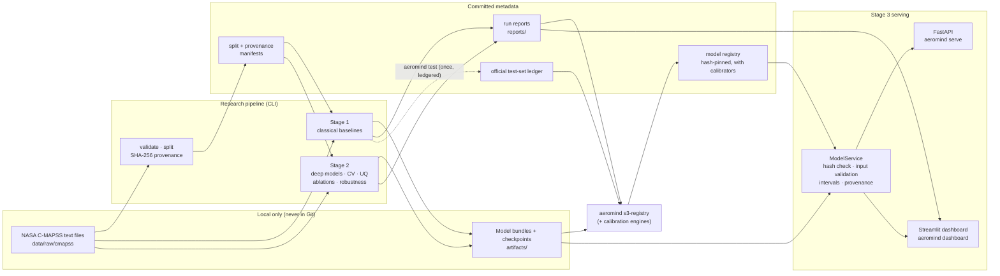

# Architecture

## System overview



The registry is the contract between research and serving. It lists every servable bundle by
path and SHA-256, copies metrics from the run reports, and holds the conformal calibrators.
The service refuses to unpickle a bundle whose hash differs from the registry.

## Stage-1 data and model flow

```
raw NASA files ──► data.cmapss (parse + validate + RUL) ──► data.splits (engine-level manifest)
                                                     │
                                  ┌──────────────────┴─────────────────────┐
                                  ▼                                        ▼
                         eda (pool | train scope)          features.FeaturePipeline.fit(train engines)
                                                                           │
                                         models.factory ──► estimator.fit(train rows)
                                                                           │
                                       models.bundle.RULPredictor(pipeline + estimator)
                                                                           │
                    evaluation.protocol (snapshots / windows / final cycle) + metrics + plots
                                                                           │
                       experiments.{train, evaluate, test_eval, compare}  ◄── cli.py
```

## Packages

| Module | Responsibility |
|---|---|
| `aeromind.data.cmapss` | 26-column schema, field-count / numeric / finite / integer / contiguous-cycle checks, `load_train` (never reads labels), `load_test` (only label reader), `validate_dataset`, sensor metadata |
| `aeromind.data.provenance` | SHA-256 manifests of raw files; verification |
| `aeromind.data.splits` | `make_engine_split`, `verify_split`, `save_split` (refuses silent changes) |
| `aeromind.eda` | `analysis.py` pure functions; `report.py` writes CSV/JSON/PNG per scope |
| `aeromind.features` | `targets` (capping), `rolling` (causal trailing stats), `conditions` (k-means regimes), `pipeline` (fitted state) |
| `aeromind.models` | `baselines` (median, mean residual life), `factory` (seeded estimators, grids), `bundle` (save/load) |
| `aeromind.evaluation` | `metrics` (MAE, RMSE, bias, PHM08), `protocol` (snapshots, weights, bins), `plots` |
| `aeromind.experiments` | Workflows called by the CLI; `smoke.py` for the synthetic path |
| `aeromind.synthetic` | Synthetic C-MAPSS-format generator for tests and smoke runs |
| `aeromind.config` | Typed YAML config; unknown keys are errors |
| `aeromind.deep` | Stage 2: causal windows, TCN/GRU/Transformer, deterministic trainer, `DeepRULPredictor` |
| `aeromind.research` | Stage 2: CV comparison, UQ, ablations, robustness (one process per model) |
| `aeromind.serving.registry` | Stage 3: registry build (bundle hashes, metrics from reports, ledger-only test metrics, conformal calibrators) |
| `aeromind.serving.service` | Stage 3: `ModelService` (lazy hash-verified loading, input validation, intervals, provenance, typed errors) |
| `aeromind.serving.{benchmark,artifacts,cards,maintenance,smoke}` | CPU benchmark; bundle export/import; model cards; hypothetical maintenance simulation; synthetic smoke |
| `aeromind.api.app` | FastAPI app: `/health`, `/models`, `/models/{id}`, `/models/{id}/predict`, `/models/{id}/predict/batch` |
| `aeromind.dashboard` | Streamlit app (`app.py`) and Streamlit-free data loaders (`data.py`) |

## Design decisions

- **One predictor object for training and inference.** `RULPredictor.predict(frame)` runs the
  fitted pipeline and the estimator. The saved bundle contains both, so preprocessing cannot
  diverge between training and deployment.
- **Stateless causal features.** Rolling features need no fitted state, so a prediction for
  one engine depends only on that engine's history. This is tested.
- **Predictions are clipped to `[0, cap]`.** Values above the training cap are not identifiable.
- **Age baseline consumes raw `cycle`.** `input_kind="cycle"` avoids un-scaling tricks.
- **Persistence (pickle via joblib).** Bundles are only for self-produced files. Do not load untrusted bundles.
  Stage 3 enforces this: bundles load only when their SHA-256 matches the committed registry, and
  `aeromind s3-import` installs archive members only on an exact path-and-hash match.
- **One service for API and dashboard.** Both call `ModelService.predict_engine`, so the two
  interfaces cannot disagree. Served predictions are tested to equal the saved Stage-2
  predictions.
- **No silent fallbacks.** A missing, tampered or torch-requiring bundle is reported as
  unavailable (HTTP 503). Nothing substitutes a different model or a placeholder value.

## Run directory layout

```
artifacts/runs/<name>_<timestamp>/
  config.yaml            resolved configuration
  metadata.json          hashes, split hash, engine IDs, env, timings, peak RSS, test-evaluation log
  models/<family>.joblib best grid point per family
  predictions/           validation snapshot and all-window predictions (all families)
  report/                CSV/JSON/PNG summaries (+ test/ after `aeromind test`)
```
